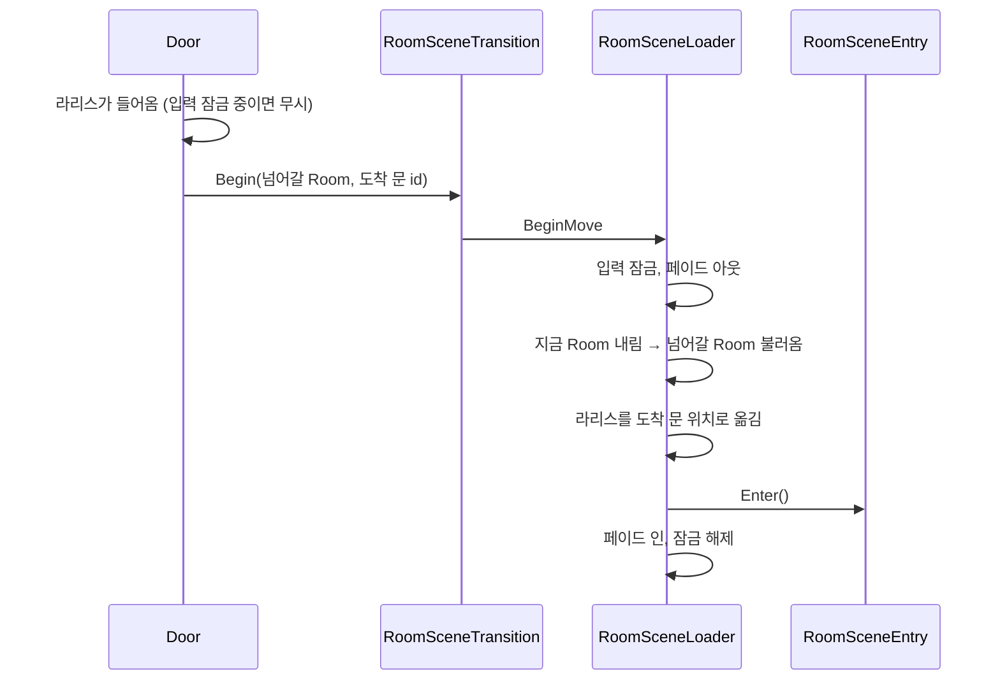

# Room
---
- 지도를 Room 씬 단위로 나눠 불러오는 시스템.

- `Core` 씬은 늘 떠 있고, 그 위에 Room 씬 하나를 additive로 불러옴.
	- `Core`: 라리스, 카메라, 대화, 입력 잠금 등 → [[세션 시스템]]
	- Room 씬: 바닥, 벽, 조사 대상, 죽음 트리거, 문

- Room 사이는 문(`Door`)으로 넘어감.
	- 넘어갈 때 페이드 아웃 → 페이드 인.
	- Room 이동은 세이브하지 않음.

- 지금 있는 Room 씬: `Prototype01`, `Prototype02`
	- 기본 Room: `Prototype02` (`CoreEntry`에 설정)

- 빈 방 템플릿: `Assets/Scenes/Templates/RoomTemplate.unity`
	- 빌드 설정에는 넣지 않음.

# 구성
---

| 이름                    | 하는 일                                                                     |
| --------------------- | ------------------------------------------------------------------------ |
| `RoomSceneLoader`     | Room 씬 불러오기·내리기, 문으로 Room 이동. `Core` 씬에 하나만 둠.                        |
| `RoomSceneEntry`      | Room 씬마다 하나. Room에 들어올 때 `DeathAftermath`를 적용함. → [[죽음 시스템]]           |
| `Door`                | 문의 공통 부분(abstract). 라리스가 들어가면 행선지 문으로 이동. 이 문의 위치가 도착 위치. 자식 클래스가 `ResolveTarget`으로 행선지를, `CanEnter`로 들어갈 조건을 정함. |
| `PairDoor`            | 행선지가 하나인 문. `targetScene`·`targetDoorId`로 이어짐.                           |
| `RoomSceneTransition` | 문이 `Core`의 `RoomSceneLoader`를 찾아 이동을 맡기는 다리.                             |
| `PixelSnap`           | 에디터에서 오브젝트 위치를 픽셀 격자(16 PPU)에 맞춤. 플레이 중에는 아무것도 안 함.                   |

# 흐름
---

- 시작할 때와 죽어서 다시 시작할 때는 문을 거치지 않음.
	- `CoreEntry`가 세이브된 Room을 바로 불러옴. → [[세션 시스템]]

- 도착한 문에 바로 다시 들어가지 않도록, 라리스가 문 트리거 밖으로 나가야 그 문이 다시 켜짐.

# 쓰는 법
---
- **Room 만들기**
	1. `RoomTemplate`을 복제해 `Assets/Scenes/`에 둠.
		- 템플릿에 있는 것: `RoomEntry`(`RoomSceneEntry`), `Grid` 아래 `Ground`·`Door`·`Wall` 타일맵(`Ground`에만 콜라이더(Merged), 정렬 레이어 `Background`), `RoomDoor`, `Global Light 2D`(`RoomLight`, 등불 비어 있음) → [[빛 시스템]]
		- 리스폰 지점은 템플릿에 없음. 필요한 방에만 `Respawn` Pb를 놓음.
	2. 씬을 Build Settings에 추가함.
		- 없으면 넘어가지 못하고 오류가 남.
	3. 씬 이름이 곧 Room 이름. 세이브와 문이 이 이름을 씀.

- **문 잇기**
	1. 양쪽 Room에 Trigger 콜라이더와 `PairDoor`를 붙인 오브젝트를 둠.
	2. 각 문에 `doorId`를 적음.
	3. `targetScene`에 넘어갈 Room 이름, `targetDoorId`에 도착할 문의 `doorId`를 적음.
		- Ex. A의 문: `doorId` = `East`, `targetScene` = `B`, `targetDoorId` = `West`
	4. 반대쪽 문은 `반대쪽 문도 이 문으로 잇기` 버튼으로 채움.
		- 상대 씬을 열어 그 문의 `targetScene`·`targetDoorId`를 이 문으로 적고 저장한 뒤 닫음.
		- 상대 씬이 이미 열려 있으면 저장하지 않음. 직접 저장.
		- 상대 문이 다른 곳으로 이어져 있으면 바꿀지 물어봄.
	- `doorId`는 그 Room 안에서만 겹치지 않으면 됨. 방향으로 지음.
		- Ex. `East`, `West`, 한쪽에 둘이면 `East1`, `East2`
	- `targetScene`, `targetDoorId`는 Inspector 목록에서 고름. 목록은 빌드 설정의 씬과 그 씬의 문 id.

- **새 종류의 문 만들기**
	1. `Door`를 상속하고 `ResolveTarget`에서 넘어갈 Scene과 도착 문 id를 돌려줌.
	2. 들어가는 조건이 있으면 `CanEnter`를 덮어씀.
	- 문 Inspector(`DoorEditor`)는 `PairDoor`와 그 자식 클래스에만 붙음.
		- Ex. `PairDoor`를 상속하면 행선지 목록과 `반대쪽 문도 이 문으로 잇기` 버튼이 그대로 뜸.

- **벽 칠하기**
	- `Prototype_Wall_Rule`(RuleTile)로 방 전체를 속까지 채워 칠함.
		- 테두리만 칠하면 왼쪽 벽과 오른쪽 벽을 구분하지 못해 모서리가 틀어짐.
		- 바닥 칸은 그림도 콜라이더도 없어서 화면에는 안 보임. 바닥 그림은 `Ground` 타일맵에 그대로 둠.
	- 윗벽은 3칸. `T` 한 줄 아래 `C` 두 줄이 자동으로 깔림.
	- 이웃이 없는 한 칸 벽, 한 칸 두께의 벽에는 규칙이 없어 그려지지 않음.

- **픽셀 맞추기**
	- 오브젝트에 `PixelSnap`을 붙이면 에디터에서 움직일 때 픽셀 격자에 붙음.
	- 스프라이트 피벗이 픽셀 경계에 있어야 정확히 맞음.

# 확인 필요
---

- 템플릿의 `Grid`·타일맵은 새로 만든 것. 예전 Room에는 타일맵이 없었음.
	- `Ground` 콜라이더로 라리스가 막히는지는 아직 확인 안 함.
		- `Wall` 안쪽을 채워 칠하므로 `Wall`이 아니라 `Ground`(Merged) 콜라이더를 이동 경계로 씀.

- `DoorEditor`의 행선지 문 id 목록은 `PairDoor`만 찾음.
	- 열려 있지 않은 씬은 파일에서 `PairDoor`의 `doorId`만 읽음. `PairDoor`가 아닌 문은 그 씬을 열어야 목록에 나옴.
	- `PairDoor`를 상속한 문은 스크립트 guid가 달라 마찬가지로 목록에 안 나옴.
