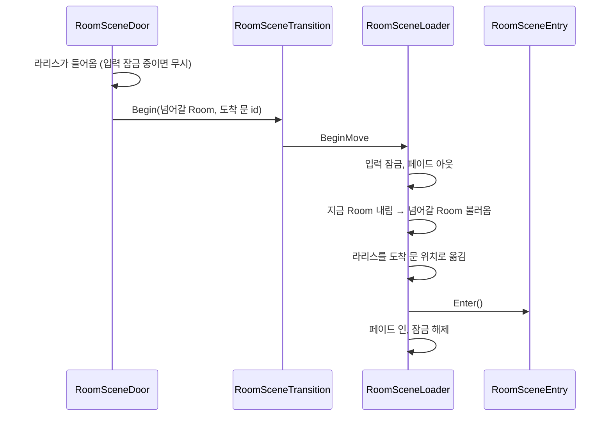

# Room
---
- 지도를 Room 씬 단위로 나눠 불러오는 시스템.

- `Core` 씬은 늘 떠 있고, 그 위에 Room 씬 하나를 additive로 불러옴.
	- `Core`: 라리스, 카메라, 대화, 입력 잠금 등 → [[세션 시스템]]
	- Room 씬: 바닥, 벽, 조사 대상, 죽음 트리거, 문

- Room 사이는 문(`RoomSceneDoor`)으로 넘어감.
	- 넘어갈 때 페이드 아웃 → 페이드 인.
	- Room 이동은 세이브하지 않음.

- 지금 있는 Room 씬: `001`, `002` (서로 문으로 이어짐)
	- 기본 Room: `002` (`Core` 씬의 `CoreEntry`에 설정)

# 구성
---

| 이름                    | 하는 일                                                                     |
| --------------------- | ------------------------------------------------------------------------ |
| `RoomSceneLoader`     | Room 씬 불러오기·내리기, 문으로 Room 이동. `Core` 씬에 하나만 둠.                        |
| `RoomSceneEntry`      | Room 씬마다 하나. Room에 들어올 때 `DeathAftermath`를 적용함. → [[죽음 시스템]]           |
| `RoomSceneDoor`       | Room 씬에 놓는 문. 라리스가 들어가면 다른 Room의 문으로 이동. 이 문의 위치가 도착 위치.          |
| `RoomSceneTransition` | 문이 `Core`의 `RoomSceneLoader`를 찾아 이동을 맡기는 다리.                             |
| `PixelSnap`           | 에디터에서 오브젝트 위치를 픽셀 격자(16 PPU)에 맞춤. 플레이 중에는 아무것도 안 함.                   |

# 흐름
---

- 시작할 때와 죽어서 다시 시작할 때는 문을 거치지 않음.
	- `CoreEntry`가 세이브된 Room을 바로 불러옴. → [[세션 시스템]]

- 도착한 문에 바로 다시 들어가지 않도록, 라리스가 문 트리거 밖으로 나가야 그 문이 다시 켜짐.

# 쓰는 법
---
- **Room 만들기**
	1. 새 씬을 만들고 루트 아래에 `RoomSceneEntry`를 붙인 오브젝트를 둠.
	2. 씬을 Build Settings에 추가함.
		- 없으면 넘어가지 못하고 오류가 남.
	3. 씬 이름이 곧 Room 이름. 세이브와 문이 이 이름을 씀.

- **문 잇기**
	1. 양쪽 Room에 Trigger 콜라이더와 `RoomSceneDoor`를 붙인 오브젝트를 둠.
	2. 각 문에 `doorId`를 적음.
	3. `targetScene`에 넘어갈 Room 이름, `targetDoorId`에 도착할 문의 `doorId`를 적음.
		- Ex. `001`의 문: `doorId` = `RoomDoorTest001`, `targetScene` = `002`, `targetDoorId` = `RoomDoorTest002`

- **픽셀 맞추기**
	- 오브젝트에 `PixelSnap`을 붙이면 에디터에서 움직일 때 픽셀 격자에 붙음.
	- 스프라이트 피벗이 픽셀 경계에 있어야 정확히 맞음.

# 확인 필요
---
- `CoreEntry`의 코드 기본값은 `ParkingLot`이지만 `Core` 씬에서는 `002`로 덮어씀.
	- `ParkingLot` 씬은 프로젝트에 없음.

- 카메라가 아직 20×15칸이 아님. Room 크기를 정하기 전에 맞춰야 함.
