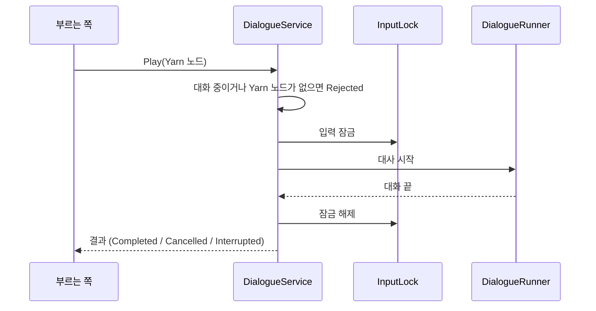

# 대화
---
- Yarn Spinner로 대사를 재생하는 시스템.

- 대사는 `Assets/Resources/Dialogue/Prototype.yarn` 하나에 있음.

- 대사가 재생되는 동안 소녀는 움직일 수 없음. → [[세션 시스템]]

- 재생이 끝나면 결과를 돌려줌.
	- `Completed`: 끝까지 봄
	- `Rejected`: 시작하지 못함 (이미 대화 중, Yarn 노드 없음)
	- `Cancelled`: 취소로 끊김
	- `Interrupted`: 그 밖의 이유로 끊김

# 구성
---

| 이름                     | 하는 일                                                                         |
| ---------------------- | ---------------------------------------------------------------------------- |
| `DialogueService`      | Yarn 노드 하나를 재생하고 결과를 돌려줌. 재생 중 입력 잠금, 취소, 변수 초기화, Yarn 노드 존재 확인.          |
| `DialogueResult`       | 재생 결과 네 가지.                                                                  |
| `CutsceneCommand`      | `<<Cutscene id>>`, `<<CutsceneEnd>>` 커맨드. 대사창 뒤에 이미지를 띄움.                      |
| `PlayerNameCommand`    | `<<UsePcUserName>>`, `<<AskPlayerName>>` 커맨드. 플레이어 이름을 정하고 바로 저장함. → [[세이브 시스템]] |
| `PlayerNameFunctions`  | `pc_user_name()`, `player_name()` Yarn 함수. 플레이어 이름을 Yarn에 넘김.                  |
| `PunctuationPause`     | 타자기로 대사를 찍을 때 ` ` 줄바꿈과 문장부호 뒤에서 자동으로 잠깐 멈춤. `LinePresenter`의 `eventHandlers`에 들어감. |
| `OptionInputPresenter` | 선택지가 떠 있는 동안 취소 입력과 ↑↓ 이동을 맡음.                                              |
| `ContinueIndicator`    | 대사 출력이 끝나 입력을 기다리는 동안 표시를 깜박임.                                               |
| `DialogueZone`         | 소녀가 영역에 들어오면 Yarn 노드를 한 번 재생. 끝까지 보면 조사 기록에 남아 다시 재생하지 않음. → [[상호작용 시스템]] |
| `DialogueNodeNames`    | Yarn 노드 이름 규칙. 재조사 Yarn 노드 이름(`_Recheck`)을 만듦. → [[상호작용 시스템]]                |
| `YarnNodeCheck`        | Inspector에 적은 Yarn 노드 이름이 Yarn 프로젝트에 있는지 에디터에서 검사.                          |

- 관련 프리팹: `Prefabs/UI/Dialogue/DialogueSystem` (러너, 프레젠터들), `Prefabs/UI/Dialogue/OptionItem`

# 흐름
---

- 부르는 쪽
	- 조사 대상 → [[상호작용 시스템]]
	- 사망 대사, 외면 대사, 창 닫기 사망 대사 → [[죽음 시스템]]

- 취소는 선택지가 떠 있을 때 취소 키로만 됨.
	- 죽을 때는 `DeathSequence`가 진행 중인 대사를 직접 끊음. → [[죽음 시스템]]

# 쓰는 법
---
- **대사 쓰기**
	- `Prototype.yarn`에 Yarn 노드를 씀.
	- 조사, 사망, 외면 대사는 각 대상의 Inspector에 Yarn 노드 이름을 적어 연결.
		- Ex. 조사 대사 → `DialogueResponse`의 `dialogueNodeId`
	- 없는 이름을 적으면 에디터 콘솔에 경고가 뜸 (`YarnNodeCheck`).

- **Yarn 커맨드**

| 커맨드                | 하는 일                                                                       |
| ------------------ | -------------------------------------------------------------------------- |
| `<<Cutscene id>>`  | `Assets/Resources/Cutscenes/{id}` 이미지를 대사창 뒤에 띄움. 대사는 계속 진행. Ex. `<<Cutscene FallenDieCutScene>>` |
| `<<CutsceneEnd>>`  | 컷신 이미지를 닫음. 대화가 끝나도 닫힘.                                                    |
| `<<QuitNormally>>` | 게임을 정상 종료함 (창 닫기 사망이 아님). → [[세션 시스템]]                                    |
| `<<stop>>`         | Yarn 기본 커맨드. 대화를 끝냄. `Completed`로 처리.                                      |
| `<<UsePcUserName>>` | PC 사용자 이름을 플레이어 이름으로 저장함. 나중에 Windows 사용자 이름이 바뀌어도 저장한 이름은 그대로. |
| `<<AskPlayerName>>` | 이름 입력창(`NameInput`)을 띄우고, Enter로 확정할 때까지 대사를 멈춤. 확정하면 바로 저장함. 공백뿐이면 확정되지 않음. 최대 8글자. 기다리는 중 대화가 끊기면 저장하지 않고 닫음. |

- **Yarn 함수**
	- 대사 안에서 `{ }`로 부름.
		- Ex. `Girl: 그럼 {player_name()}, 잘 들어!`

| 함수               | 돌려주는 것                                    |
| ---------------- | ----------------------------------------- |
| `pc_user_name()` | 이 PC의 Windows 사용자 이름                       |
| `player_name()`  | 정한 플레이어 이름. 아직 없으면 PC 사용자 이름                |

- 플레이어 이름은 Yarn 변수에 담지 않고 함수로 세이브에서 읽음.
	- Yarn 변수는 죽으면 지워지기 때문.

- **대사 템포**
	- 줄바꿈과 문장부호 뒤에서는 자동으로 멈춤 (`PunctuationPause`).
		- ` ` 뒤 200ms, `. ! ? … ~` 뒤 150ms, `,` 뒤 80ms. `LinePresenter` 오브젝트의 Inspector에서 바꿈.
		- 부호가 이어지면(`...`, `?!`) 마지막 부호 뒤에서 한 번만 멈춤. 줄바꿈과 겹치면 긴 쪽.
	- 특별히 멈칫할 곳은 대사 안에 `[pause=밀리초 /]`를 씀. 자동 멈춤에 더해짐.
		- Ex. `Girl: 음...[pause=1000 /] 내가 지을래!`
	- 대사와 대사 사이를 비우려면 `<<wait 초>>`.
	- Z로 대사를 넘기면 멈춤도 건너뜀.

- **들어가면 한 번 재생되는 대사 (영역)**
	1. 오브젝트에 Trigger 콜라이더와 `DialogueZone`을 붙임.
	2. `dialogueNodeId`에 Yarn 노드 이름을 적고, Yarn에 같은 이름의 Yarn 노드를 씀.
		- Ex. 첫 만남: 방1의 시작 위치에 깔고 `FirstMeeting`
	- 끝까지 보면 `investigatedNodeIds`에 남아 다시 재생하지 않음. 중간에 끊으면 다음에 또 재생함.
	- 이미 영역 안에서 시작해도 재생됨. `OnTriggerStay2D`에서 확인함.
	- 재생하지 못했으면(`Rejected`) 영역을 나갔다 다시 들어올 때까지 다시 시도하지 않음.
	- 다른 대화 중이거나 사망 중이면 재생하지 않고, 영역 안에 있는 동안 조건이 풀리면 재생함.

- **코드에서 대사 재생**
	- `DialogueService.Play("노드 이름")`을 부르고 결과를 기다림.
	- 다른 대화 중이면 `Rejected`. 미리 `IsIdle`로 확인 가능.

# 확인 필요
---
- Yarn 변수(`<<set $변수 to 값>>`)는 세이브되지 않음.
	- 게임을 껐다 켜면 지워짐.
	- 죽어서 다시 시작할 때도 지워짐 (`CoreEntry`가 `ResetVariables`를 부름). → [[세션 시스템]]
	- Ex. 빛나는 돌을 보여 준 뒤 `<<set $saw_stone to true>>` → 소녀가 죽음 → `$saw_stone`은 다시 false → 소녀가 돌 이야기를 처음 하는 것처럼 함.
	- 지금 세이브에 남는 건 조사 기록과 사망 기록뿐. → [[세이브 시스템]]
		- 이것도 Yarn에서 읽을 방법이 없음. "이 돌을 조사했으면 다른 대사" 같은 분기를 Yarn 안에서 못 씀.
	- 지금 `Prototype.yarn`은 Yarn 변수를 쓰지 않아서 문제가 드러나지 않았음.
	- 이벤트 플래그를 만들기 전에 정해야 함.
		- 죽어도 남는 기억(Yarn 변수를 세이브에 저장)과 죽으면 되감기는 것(지금처럼 지움)을 나눌지.

- `<<QuitNormally>>`를 쓰는 Yarn 노드가 아직 없음.
	- 그래서 지금은 정상 종료할 방법이 없음.

- 이름 입력창에서 실제 키 입력은 플레이로 확인 안 함.
	- 확인한 것: 입력창이 뜨는 동안 다음 줄로 넘어가지 않음, 공백은 확정 안 됨, 확정하면 저장되고 다음 줄에서 읽힘.
	- 확인 안 한 것: 'z'를 칠 때 대사가 넘어가지 않는지, 한글(IME) 조합이 되는지.
		- 프로젝트가 새 Input System만 써서 한글 조합이 안 될 수 있음.

- `DialogueZone`의 에디트 모드 테스트는 `HandleInside`·`HandleExited`만 봄.
	- 이미 영역 안에서 시작할 때 `OnTriggerStay2D`가 오는지는 플레이로 확인해야 함.

- 컷신 이미지는 `Resources/Cutscenes/`에 있어야 함. 없으면 경고만 남기고 넘어감.
