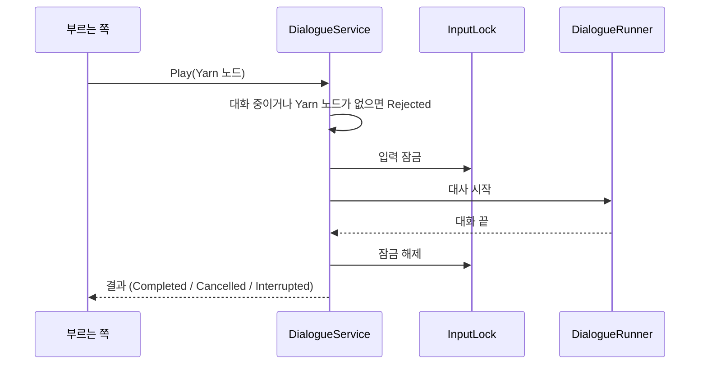

# 대화
---
- Yarn Spinner로 대사를 재생하는 시스템.

- 대사는 `Assets/Resources/Dialogue/Prototype.yarn` 하나에 있음.

- 대사가 재생되는 동안 라리스는 움직일 수 없음. → [[세션 시스템]]

- 재생이 끝나면 결과를 돌려줌.
	- `Completed`: 끝까지 봄
	- `Rejected`: 시작하지 못함 (이미 대화 중, Yarn 노드 없음)
	- `Cancelled`: 취소로 끊김
	- `Interrupted`: 그 밖의 이유로 끊김

# 구성
---

| 이름                     | 하는 일                                                                         |
| ---------------------- | ---------------------------------------------------------------------------- |
| `DialogueService`      | Yarn 노드 하나를 재생하고 결과를 돌려줌. 재생 중 입력 잠금, 취소, 변수 초기화, Yarn 노드 존재 확인.          |
| `DialogueResult`       | 재생 결과 네 가지.                                                                  |
| `CutsceneCommand`      | `<<Cutscene id>>`, `<<CutsceneEnd>>` 커맨드. 대사창 뒤에 이미지를 띄움.                      |
| `OptionInputPresenter` | 선택지가 떠 있는 동안 취소 입력과 ↑↓ 이동을 맡음.                                              |
| `ContinueIndicator`    | 대사 출력이 끝나 입력을 기다리는 동안 표시를 깜박임.                                               |
| `DialogueNodeNames`    | Yarn 노드 이름 규칙. 재조사 Yarn 노드 이름(`_Recheck`)을 만듦. → [[상호작용 시스템]]                |
| `YarnNodeCheck`        | Inspector에 적은 Yarn 노드 이름이 Yarn 프로젝트에 있는지 에디터에서 검사.                          |

- 관련 프리팹: `Prefabs/Dialogue/DialogueSystem` (러너, 프레젠터들), `Prefabs/Dialogue/OptionItem`

# 흐름
---

- 부르는 쪽
	- 조사 대상 → [[상호작용 시스템]]
	- 사망 대사, 외면 대사, 창 닫기 사망 대사 → [[죽음 시스템]]

- 취소는 선택지가 떠 있을 때 취소 키로만 됨.
	- 죽을 때는 `DeathSequence`가 진행 중인 대사를 직접 끊음. → [[죽음 시스템]]

# 쓰는 법
---
- **대사 쓰기**
	- `Prototype.yarn`에 Yarn 노드를 씀.
	- 조사, 사망, 외면 대사는 각 대상의 Inspector에 Yarn 노드 이름을 적어 연결.
		- Ex. 조사 대사 → `DialogueInteractable`의 `dialogueNodeId`
	- 없는 이름을 적으면 에디터 콘솔에 경고가 뜸 (`YarnNodeCheck`).

- **Yarn 커맨드**

| 커맨드                | 하는 일                                                                       |
| ------------------ | -------------------------------------------------------------------------- |
| `<<Cutscene id>>`  | `Assets/Resources/Cutscenes/{id}` 이미지를 대사창 뒤에 띄움. 대사는 계속 진행. Ex. `<<Cutscene FallenDieCutScene>>` |
| `<<CutsceneEnd>>`  | 컷신 이미지를 닫음. 대화가 끝나도 닫힘.                                                    |
| `<<QuitNormally>>` | 게임을 정상 종료함 (창 닫기 사망이 아님). → [[세션 시스템]]                                    |
| `<<stop>>`         | Yarn 기본 커맨드. 대화를 끝냄. `Completed`로 처리.                                      |

- **코드에서 대사 재생**
	- `DialogueService.Play("노드 이름")`을 부르고 결과를 기다림.
	- 다른 대화 중이면 `Rejected`. 미리 `IsIdle`로 확인 가능.

# 확인 필요
---
- Yarn 변수는 세이브되지 않음.
	- 죽어서 다시 시작할 때도 지워짐 (`CoreEntry`가 `ResetVariables`를 부름). → [[세션 시스템]]
	- 이벤트 플래그로 쓰려면 저장 방법이 따로 필요.

- `<<QuitNormally>>`를 쓰는 Yarn 노드가 아직 없음.
	- 그래서 지금은 정상 종료할 방법이 없음.

- 컷신 이미지는 `Resources/Cutscenes/`에 있어야 함. 없으면 경고만 남기고 넘어감.
