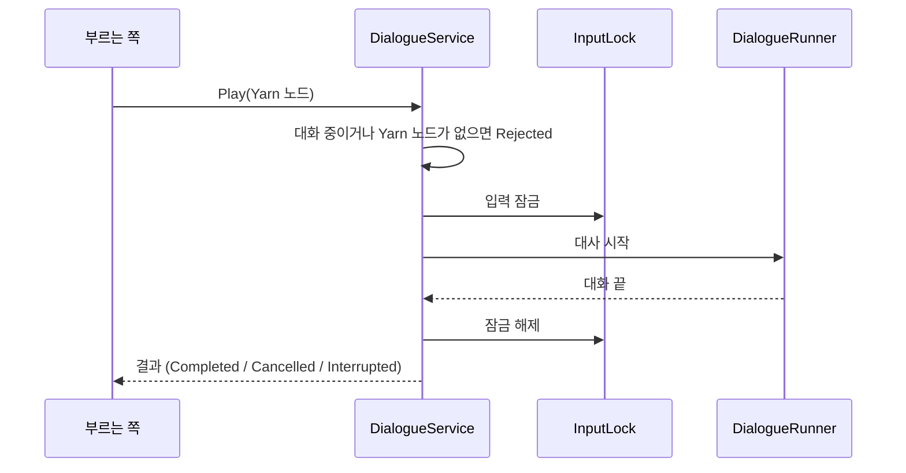

# 대화
---
- Yarn Spinner로 대사를 재생하는 시스템.

- 대사는 `Assets/Resources/Dialogue/`의 Yarn 파일에 있음.
	- `Apartment.yarn`: 첫 지역(거실, 방 1~4) 대사.
	- `Prototype.yarn`: 시험용 대사와 창 닫기 사망 대사.

- 대사가 재생되는 동안 소녀는 움직일 수 없음. → [[세션 시스템]]

- 재생이 끝나면 결과를 돌려줌.
	- `Completed`: 끝까지 봄
	- `Rejected`: 시작하지 못함 (이미 대화 중, Yarn 노드 없음)
	- `Cancelled`: 취소로 끊김
	- `Interrupted`: 그 밖의 이유로 끊김

# 구성
---

| 이름                         | 하는 일                                                                                                                                                                             |
| -------------------------- | -------------------------------------------------------------------------------------------------------------------------------------------------------------------------------- |
| `DialogueService`          | Yarn 노드 하나를 재생하고 결과를 돌려줌. 재생 중 입력 잠금, 취소, 변수 초기화, Yarn 노드 존재 확인.                                                                                                              |
| `DialogueResult`           | 재생 결과 네 가지.                                                                                                                                                                      |
| `CutsceneCommand`          | `<<Cutscene id>>`, `<<CutsceneEnd>>` 커맨드. 대사창 뒤에 이미지를 띄움.                                                                                                                        |
| `PlayerNameCommand`        | `<<UsePcUserName>>`, `<<AskPlayerName>>` 커맨드. 플레이어 이름을 정하고 바로 저장함. → [[세이브 시스템]]                                                                                                 |
| `PlayerNameFunctions`      | `pc_user_name()`, `player_name()` Yarn 함수. 플레이어 이름을 Yarn에 넘김.                                                                                                                    |
| `AlphaFollow`              | 이 오브젝트의 알파를 다른 `CanvasGroup`의 알파에 맞춤. `LastLine`(선택지 위에 남기는 직전 대사)이 선택지가 끝나면 같이 꺼지게 `OptionsPresenter`의 알파를 따라가게 함.                                                           |
| `DialogueBackgroundFollow` | 대화창 배경(`Dialogue Background`)을 대사나 선택지가 보일 때만 서서히 켜고 끔. 배경이 다 켜지기 전에는 대사의 첫 글자가 나오지 않음. 선택지 ↔ 대사 전환에서는 깜박이지 않게 잠깐(`hideDelay`) 기다림. `LinePresenter`의 `eventHandlers`에 들어감. |
| `WaveEffect`               | `[wave]` 구간 글자를 위아래로 출렁이게 함. `LinePresenter`의 `eventHandlers`에 들어감.                                                                                                              |
| `ShakeEffect`              | `[shake]` 구간 글자를 글자마다 따로 덜덜 떨게 함. `LinePresenter`의 `eventHandlers`에 들어감.                                                                                                         |
| `MarkupMotionEffect`       | `WaveEffect`, `ShakeEffect`의 공통 부분. 마커 구간 글자를 골라 매 프레임 움직임. 대사가 닫히고 선택지가 뜨면 `LastLine`에서 같은 글자를 이어서 움직임. 다음 대사가 시작되면 대사 글자로 돌아옴. |
| `RectFollow`               | 이 오브젝트의 위치와 크기를 다른 RectTransform에 늘 맞춤. 에디터에서도 따라감. `LastLine`이 `LinePresenter / Text`와 겹치게 함.                                                                       |
| `TextMotion`               | 글자를 움직이는 효과들이 한 대사의 메시를 나눠 씀. 원래 자리로 되돌리기를 한 프레임에 한 번만 해서 `[wave]`와 `[shake]`를 한 대사에 같이 써도 서로 지우지 않음.                                                       |
| `PunctuationPause`         | 타자기로 대사를 찍을 때 ` ` 줄바꿈과 문장부호 뒤에서 자동으로 잠깐 멈춤. `LinePresenter`의 `eventHandlers`에 들어감.                                                                                         |
| `OptionInputPresenter`     | 선택지가 떠 있는 동안 취소 입력과 ←→ 이동을 맡음.                                                                                                                                                   |
| `ContinueIndicator`        | 대사 출력이 끝나 입력을 기다리는 동안 표시를 깜박임.                                                                                                                                                   |
| `DialogueZone`             | 소녀가 영역에 들어오면 Yarn 노드를 한 번 재생. 끝까지 보면 조사 기록에 남아 다시 재생하지 않음. → [[상호작용 시스템]]                                                                                                        |
| `DialogueNodeNames`        | Yarn 노드 이름 규칙. 재조사 Yarn 노드 이름(`_Recheck`)을 만듦. → [[상호작용 시스템]]                                                                                                                    |
| `YarnNodeCheck`            | Inspector에 적은 Yarn 노드 이름이 Yarn 프로젝트에 있는지 에디터에서 검사.                                                                                                                               |

- 관련 프리팹: `Prefabs/UI/Dialogue/DialogueSystem` (러너, 프레젠터들), `Prefabs/UI/Dialogue/OptionItem`

- 대화창은 상자 두 개임. 아래는 대사 상자(`Container / Line`), 그 위는 선택지 상자(`Container / Options`).
	- 대사 칸은 2줄. 글자는 위쪽 왼쪽 정렬이라 줄 수가 바뀌어도 첫 줄 자리가 같음.
	- 선택지가 뜨면 대사 상자에 직전 대사(`LastLine`)가 남음. `LastLine`은 `Text`와 위치, 크기, 글꼴이 같음.
		- 위치와 크기는 `RectFollow`가 `Text`를 따라감. 대사 칸은 `Text`만 고치면 됨.
		- 글꼴, 크기, 정렬, 줄 간격은 따라가지 않음. `Text`를 바꾸면 `LastLine`도 같이 바꿔야 함.
		- `[wave]`, `[shake]` 움직임도 `LastLine`에서 이어짐. 효과의 `lastLineText`에 `LastLine`을 넣어 둠.
	- 선택지는 `OptionsPresenter`의 `HorizontalLayoutGroup`으로 가로로 놓임.
	- 레이아웃 그룹과 `ContentSizeFitter`는 `OptionsPresenter` 말고는 꺼 둠. 내용에 따라 칸이 늘지 않음.

- 대화창 UI의 위치, 크기, 줄 간격은 3의 배수로 둠.
	- UI 기준 해상도가 1920×1080이라 640×360에서는 1/3, 1280×720에서는 2/3로 줄어듦. 3의 배수가 아니면 화면 픽셀 사이에 걸려 글자와 테두리가 흐려짐.
	- 대사 폰트도 36pt(글꼴 픽셀 하나가 3)라서 글자 위치가 3의 배수여야 또렷함.
	- 줄 간격(`lineSpacing`) 25 → 한 줄이 57.
	- 상자는 `Container` 가운데를 기준으로 놓여서, 가장자리가 3의 배수가 되도록 `Pos`를 맞춤.
		- Ex. `Line` Pos (-6, -333), 폭 1038, 높이 300 → 640×360에서 (145, 19) ~ (491, 119).

- 대화창 오브젝트는 늘 켜져 있음. 보이고 숨는 것은 투명도로만 함.
	- `Line`과 `Options`는 각자 `DialogueBackgroundFollow`가 `CanvasGroup` 알파로 켜고 끔. 대사와 선택지는 Yarn 프레젠터가 켜고 끔.
		- `Line`은 대사나 선택지가 보일 때, `Options`는 선택지가 보일 때만 켜짐.
	- `LinePresenter`는 알파 0으로 시작함. 첫 대화 전에 배경이 뜨지 않게.

# 흐름
---

- 부르는 쪽
	- 조사 대상 → [[상호작용 시스템]]
	- 사망 대사, 외면 대사, 창 닫기 사망 대사 → [[죽음 시스템]]

- 취소는 선택지가 떠 있을 때 취소 키로만 됨.
	- 죽을 때는 `DeathSequence`가 진행 중인 대사를 직접 끊음. → [[죽음 시스템]]

# 쓰는 법
---
- **대사 쓰기**
	- `Prototype.yarn`에 Yarn 노드를 씀.
	- 조사, 사망, 외면 대사는 각 대상의 Inspector에 Yarn 노드 이름을 적어 연결.
		- Ex. 조사 대사 → `DialogueResponse`의 `dialogueNodeId`
	- 없는 이름을 적으면 에디터 콘솔에 경고가 뜸 (`YarnNodeCheck`).

- **Yarn 커맨드**

| 커맨드                 | 하는 일                                                                                                               |
| ------------------- | ------------------------------------------------------------------------------------------------------------------ |
| `<<Cutscene id>>`   | `Assets/Resources/Cutscenes/{id}` 이미지를 대사창 뒤에 띄움. 대사는 계속 진행. Ex. `<<Cutscene FallenDieCutScene>>`               |
| `<<CutsceneEnd>>`   | 컷신 이미지를 닫음. 대화가 끝나도 닫힘. 사망 대사에서는 대화가 끝나도 닫히지 않고 리스폰 때 닫힘. 사망 페이드 아웃까지 컷신이 화면을 덮음. → [[죽음 시스템]] 사망 대사 끝에 `<<CutsceneEnd>>`를 쓰면 페이드 아웃 전에 장면이 보임. |
| `<<QuitNormally>>`  | 게임을 정상 종료함 (창 닫기 사망이 아님). → [[세션 시스템]]                                                                             |
| `<<stop>>`          | Yarn 기본 커맨드. 대화를 끝냄. `Completed`로 처리.                                                                              |
| `<<UsePcUserName>>` | PC 사용자 이름을 플레이어 이름으로 저장함. 나중에 Windows 사용자 이름이 바뀌어도 저장한 이름은 그대로.                                                 |
| `<<AskPlayerName>>` | 이름 입력창(`NameInput`)을 띄우고, Enter로 확정할 때까지 대사를 멈춤. 확정하면 바로 저장함. 공백뿐이면 확정되지 않음. 최대 8글자. 기다리는 중 대화가 끊기면 저장하지 않고 닫음. |

- **Yarn 함수**
	- 대사 안에서 `{ }`로 부름.
		- Ex. `Girl: 그럼 {player_name()}, 잘 들어!`

| 함수               | 돌려주는 것                                    |
| ---------------- | ----------------------------------------- |
| `pc_user_name()` | 이 PC의 Windows 사용자 이름                       |
| `player_name()`  | 정한 플레이어 이름. 아직 없으면 PC 사용자 이름                |

- 플레이어 이름은 Yarn 변수에 담지 않고 함수로 세이브에서 읽음.
	- Yarn 변수는 죽으면 지워지기 때문.

- 함수가 돌려주는 이름은 색 태그(`<color>`)로 감싸여 있음. 이름이 나오는 모든 대사가 같은 색이 됨.
	- 색은 팔레트(`GazeTags`)의 `name` 마커에서 바꿈. 코드를 고치지 않음.
		- 팔레트를 못 읽으면 노란색(`#FFD27A`)으로 나옴.
	- 저장할 때는 태그 없는 원본(`PcUserName()`)을 씀.

- **글자 효과**
	- 대사 안에 `[이름]...[/이름]`으로 감싸 씀. 효과는 감정 하나씩만 맡김.
	- Ex. `Girl: [wave]설마...설마...![/wave]`

| 효과        | 하는 일                        | 맡은 감정           |
| --------- | --------------------------- | --------------- |
| `[wave]`  | 글자가 위아래로 출렁임 (`WaveEffect`) | 들뜸, 설렘          |
| `[shake]` | 글자가 덜덜 떨림 (`ShakeEffect`)   | 아픔, 두려움         |
| `[big]`   | 글자가 130%로 커짐                | 외침, 놀람          |
| `[small]` | 글자가 70%로 작아짐                | 혼잣말, 속삭임        |
| `[red]`   | 글자가 빨간색(`#E04848`)이 됨       | 위험, 피 (쓸 곳은 미정) |

	- 이름 색은 태그를 쓰지 않고 `{player_name()}`만 쓰면 입혀짐.
	- `[big]`, `[small]`, `[red]`는 `Assets/Resources/Dialogue/GazeTags.asset`(`MarkupPalette`)에 정의됨.
		- 이름 색 코드가 `Resources.Load`로 읽어서 `Resources` 안에 있어야 함.
		- 새 효과나 색은 이 애셋에 마커를 더하면 됨. 색은 `BasicMarker`에서 `CustomColor`를 켜고 색을 고름.
		- 굵게는 폰트(Galmuri)가 번질 수 있고 `[big]`과 역할이 겹쳐서 뺌.
	- `[shake]`는 아픔·두려움 전용으로 아껴 둠.

- **대사 템포**
	- 줄바꿈과 문장부호 뒤에서는 자동으로 멈춤 (`PunctuationPause`).
		- ` ` 뒤 200ms, `. ! ? … ~` 뒤 150ms, `,` 뒤 80ms. `LinePresenter` 오브젝트의 Inspector에서 바꿈.
		- 부호가 이어지면(`...`, `?!`) 마지막 부호 뒤에서 한 번만 멈춤. 줄바꿈과 겹치면 긴 쪽.
	- 특별히 멈칫할 곳은 대사 안에 `[pause=밀리초 /]`를 씀. 자동 멈춤에 더해짐.
		- Ex. `Girl: 음...[pause=1000 /] 내가 지을래!`
		- 쓴 자리 바로 뒤 글자가 나오기 전에 멈춤.
		- 숫자 없이 `[pause /]`만 쓰면 1초.
		- 정수는 밀리초, 소수는 초로 읽음. `[pause=1 /]`은 1ms라 멈추지 않는 것과 같음. 초로 쓰려면 `[pause=1.0 /]`.
		- 끝에 `/`를 붙여 닫음. `[pause]`처럼 닫지 않으면 대사 끝까지 감싸는 태그가 됨.
		- 처리는 Yarn Spinner의 `PauseEventProcessor`가 함. `LinePresenter`가 알아서 씀.
	- 대사와 대사 사이를 비우려면 `<<wait 초>>`.
		- Ex. `<<wait 1.5>>`
	- Z로 대사를 넘기면 멈춤도 건너뜀.

- **들어가면 한 번 재생되는 대사 (영역)**
	1. 오브젝트에 Trigger 콜라이더와 `DialogueZone`을 붙임.
	2. `dialogueNodeId`에 Yarn 노드 이름을 적고, Yarn에 같은 이름의 Yarn 노드를 씀.
		- Ex. 첫 만남: 방1의 시작 위치에 깔고 `FirstMeeting`
	- 끝까지 보면 `investigatedNodeIds`에 남아 다시 재생하지 않음. 중간에 끊으면 다음에 또 재생함.
	- 이미 영역 안에서 시작해도 재생됨. `OnTriggerStay2D`에서 확인함.
	- 재생하지 못했으면(`Rejected`) 영역을 나갔다 다시 들어올 때까지 다시 시도하지 않음.
	- 다른 대화 중이거나 사망 중이면 재생하지 않고, 영역 안에 있는 동안 조건이 풀리면 재생함.

- **코드에서 대사 재생**
	- `DialogueService.Play("노드 이름")`을 부르고 결과를 기다림.
	- 다른 대화 중이면 `Rejected`. 미리 `IsIdle`로 확인 가능.

# 확인 필요
---
- Yarn 변수(`<<set $변수 to 값>>`)는 세이브되지 않음.
	- 게임을 껐다 켜면 지워짐.
	- 죽어서 다시 시작할 때도 지워짐 (`CoreEntry`가 `ResetVariables`를 부름). → [[세션 시스템]]
	- Ex. 빛나는 돌을 보여 준 뒤 `<<set $saw_stone to true>>` → 소녀가 죽음 → `$saw_stone`은 다시 false → 소녀가 돌 이야기를 처음 하는 것처럼 함.
	- 지금 세이브에 남는 건 조사 기록과 사망 기록뿐. → [[세이브 시스템]]
		- 이것도 Yarn에서 읽을 방법이 없음. "이 돌을 조사했으면 다른 대사" 같은 분기를 Yarn 안에서 못 씀.
	- 지금 `Prototype.yarn`은 Yarn 변수를 쓰지 않아서 문제가 드러나지 않았음.
	- 이벤트 플래그를 만들기 전에 정해야 함.
		- 죽어도 남는 기억(Yarn 변수를 세이브에 저장)과 죽으면 되감기는 것(지금처럼 지움)을 나눌지.

- `[big]`, `[small]`은 글자가 흐리게 나옴. 쓰지 않고 보류.
	- 대사 폰트(Galmuri11)의 아틀라스가 36pt 한 크기로만 구워져 있어서, 다른 크기로 찍으면 보간되어 흐려짐.
	- 고치려면 큰 글자용 아틀라스를 따로 만들거나, `[big]`을 정수배(200%)로 두고 아틀라스를 Point 필터로 바꿔야 함.

- 선택지 이동 키는 `Assets/Input/InputSystem_Actions`의 UI `Navigate`에 묶인 ←→뿐임. ↑↓는 묶여 있지 않음.

- 대사 칸은 2줄까지만 들어감.
	- 3줄 대사는 칸을 넘침. 대사를 2줄 안으로 쪼개야 함.

- 글자가 또렷한지는 화면 비율이 16:9이고 640×360의 정수배일 때만 맞음.
	- 640×360, 1280×720, 1920×1080에서는 상자 가장자리와 글자 위치가 화면 픽셀에 맞음. 640×360은 계산으로 확인함.
	- 16:10 같은 다른 비율이나 1600×900처럼 정수배가 아닌 크기에서는 흐려질 수 있음.
	- 선택지 글자는 가운데 정렬이라 글자 폭에 따라 반 픽셀 어긋날 수 있음. 확인 안 함.
	- `[wave]`, `[shake]` 구간은 글자가 움직이는 동안 픽셀 사이에 걸림.

- `[pause]` 앞에 ` `이 있으면 멈추는 자리가 뒤로 밀릴 수 있음. 확인 안 함.
	- `PauseEventProcessor`는 ` `을 네 글자로 세는 Yarn 기준 위치를 쓰고, 타자기는 한 글자로 세는 TMP 기준 위치를 씀.
	- `WaveEffect`, `ShakeEffect`는 같은 어긋남을 TMP 원문 위치로 맞췄음.

- `LinePresenter`나 그 부모를 꺼진 채로 시작하게 하면 Z로 다음 대사가 안 넘어감.
	- Yarn의 `LineAdvancer`는 시작할 때 `LinePresenter`의 타자기에 등록해야 줄이 다 나온 걸 앎. `LinePresenter`가 꺼져 있으면 타자기가 아직 없어서 등록을 건너뜀.
	- 그러면 Z는 계속 "빨리 보여 주기"로만 처리됨.
	- 대화창을 숨기려고 `SetActive`를 쓰지 않음.

- `<<QuitNormally>>`를 쓰는 Yarn 노드가 아직 없음.
	- 그래서 지금은 정상 종료할 방법이 없음.

- 이름 입력창에서 실제 키 입력은 플레이로 확인 안 함.
	- 확인한 것: 입력창이 뜨는 동안 다음 줄로 넘어가지 않음, 공백은 확정 안 됨, 확정하면 저장되고 다음 줄에서 읽힘.
	- 확인 안 한 것: 'z'를 칠 때 대사가 넘어가지 않는지, 한글(IME) 조합이 되는지.
		- 프로젝트가 새 Input System만 써서 한글 조합이 안 될 수 있음.

- `DialogueZone`의 에디트 모드 테스트는 `HandleInside`·`HandleExited`만 봄.
	- 이미 영역 안에서 시작할 때 `OnTriggerStay2D`가 오는지는 플레이로 확인해야 함.

- 컷신 이미지는 `Resources/Cutscenes/`에 있어야 함. 없으면 경고만 남기고 넘어감.
