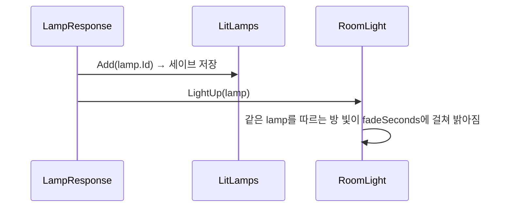

# 빛
---
- 어두운 공간 속의 빛나는 소녀.
	- 등불을 켜면 방이 밝아지는 시스템.

- 어둠은 Room 씬마다 있는 Global Light 2D.
	- 방마다 밝기가 다를 수 있음. → [[Room 시스템]]

- 라리스의 빛은 `Core` 씬의 라리스 아래에 있는 Sprite Light 2D.

- 라리스의 빛이 닿는 범위는 라리스 아래의 Trigger 콜라이더(`LarisLight`).
	- 빛 오브젝트와 형제라 숨쉬기에 따라 흔들리지 않음.
	- Room 씬의 부품이 빛 범위에 들고 나는 것을 알아볼 때 씀.

- 등불은 리스폰 지점에 붙는 조사 부품. 조사하면 켜짐. → [[상호작용 시스템]]
	- 등불 하나가 여러 방을 밝힐 수 있음.
	- 켠 등불은 세이브에 남아, 죽거나 다시 켜도 켜진 채로 있음. → [[세이브 시스템]]

# 구성
---

| 이름             | 하는 일                                                                        |
| -------------- | --------------------------------------------------------------------------- |
| `Lamp`         | 등불 하나를 가리키는 이름표 애셋. 상태는 없음. id는 애셋의 guid로 자동으로 채워짐. `Assets/Data/Lamps/` |
| `LampResponse` | 조사되면 등불을 켬. 세이브에 남기고, 지금 불러와 있는 방 중 이 등불을 따르는 방을 밝힘.                        |
| `RoomLight`    | Room 씬의 Global Light 2D에 붙음. 따르는 등불이 켜져 있으면 밝아짐. 방이 밝은지 알려 줌(`IsLit`, `IsSceneLit`). |
| `LarisLight`   | 라리스의 빛 범위 Trigger 콜라이더에 붙는 표시. 콜라이더가 빛 범위인지 알려 줌(`Is`).           |
| `LitLamps`     | 켠 등불의 id를 세이브에 저장하고 읽음. → [[세이브 시스템]]                                       |
| `LightBreath`  | 빛 오브젝트의 크기를 사인파로 키웠다 줄임.                                                    |

# 흐름
---

- 방에 들어올 때는 `RoomLight`가 켜지면서 `LitLamps`를 봄.
	- 켜진 등불이면 처음부터 `litIntensity`로 시작.
	- 아니면 씬에 적힌 밝기(어둠)로 시작.

# 쓰는 법
---
- **등불 만들기**
	1. `Assets/Data/Lamps/`에서 우클릭 → `Create` → `Gaze` → `Lamp`.
		- Ex. `Lamp_Kitchen`
	2. 리스폰 지점 오브젝트에 `LampResponse`를 붙이고 `lamp`에 1의 애셋을 넣음.

- **방을 등불에 잇기**
	1. Room 씬의 Global Light 2D에 `RoomLight`를 붙임.
	2. `lamp`에 따를 등불 애셋을 넣음.
		- 여러 방에 같은 애셋을 넣으면 등불 하나로 같이 밝아짐.
		- 비워 두면 그 방은 늘 어두움.
	3. 어두운 밝기는 Global Light 2D의 `Intensity`, 밝아진 밝기는 `litIntensity`, 밝아지는 시간은 `fadeSeconds`.

- **방이 밝은지 묻기**
	- `RoomLight.IsSceneLit(gameObject.scene)`: 그 씬의 방 빛 중 하나라도 등불이 켜져 있으면 참.
		- 밝아지는 중에도 참.
	- 방 빛은 `OnEnable`에서 등록됨. 같은 씬의 `Awake`·`OnEnable`에서 물으면 아직 없을 수 있어 `Start` 이후에 물음.

- **라리스의 빛 범위 알아보기**
	- `OnTriggerEnter2D`·`OnTriggerExit2D`에서 `LarisLight.Is(other)`로 확인.
		- `PlayerMovement.TryFrom`은 Trigger를 걸러서 빛 범위에는 거짓. → [[플레이어 시스템]]
	- 범위는 `LightCol`의 `CircleCollider2D` 반지름과 오프셋으로 조정.
		- Trigger가 아니면 라리스가 범위만큼 벽에 막힘. `LarisLight`가 시작할 때 오류를 남김.

- **처음부터 다시 어둡게 보기**
	- `Tools/데이터 초기화`로 세이브를 지움.

# 확인 필요
---
- 에디트 모드 테스트는 세이브 기록만 봄.
	- `RoomLight`가 밝아지는 건 `OnEnable`과 코루틴이라 에디트 모드 테스트에서 돌지 않음.

- 라리스가 문 칸에 서면 등 뒤 방의 벽 앞면까지 빛이 닿음.
	- 벽이 빛을 가리지 않아서 생김. 벽 너머 다른 칸이 비치는 것도 같은 이유.
	- 문 칸에 들어서면 바로 페이드돼서 지금은 거의 안 보임.
	- 나중에 그림자로 해결: 벽 타일맵에 `Shadow Caster 2D`(모양은 타일맵 콜라이더), `Self Shadows` 끔, 라리스 빛의 `Shadows` 켬.
	- 벽 윗면만 어둡게 하는 방법은 안 맞음. 방 안에서는 벽 앞면이 비쳐야 함.

- 빛 범위 콜라이더의 반지름(3칸)과 빛 그림의 반지름(`SpotLight.png`, 4칸)은 따로 정해짐.
	- 그림을 바꾸면 콜라이더도 직접 맞춰야 함.

- `LarisLight`, `IsSceneLit`을 쓰는 부품은 `ShiftingDoor`. → [[Room 시스템]]

- 등불을 켜도 라리스의 빛은 그대로.
	- 밝아진 방에서 라리스의 빛을 약하게 할지는 아직 안 정함.

- `Lamp`의 id는 에디터에서 애셋이 검사될 때 맞춰짐(`OnValidate`).
	- 애셋을 복제한 직후 한 번도 선택하지 않고 빌드하면 id가 원본과 같을 수 있음.

- 지금 Room 씬(`Room01`, `LivingRoom`, `Room02`, `Room03`)은 아직 등불을 따르지 않음. `Lamp_Prototype`을 쓰는 씬도 없음.
