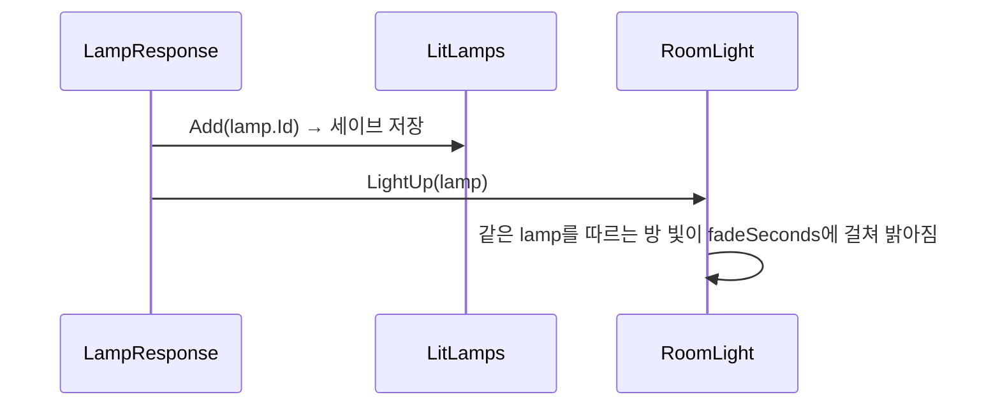

# 빛
---
- 방은 어둡고 라리스는 빛남. 등불을 켜면 방이 밝아지는 시스템.

- 어둠은 Room 씬마다 있는 Global Light 2D. 방마다 밝기가 다를 수 있음. → [[Room 시스템]]

- 라리스의 빛은 `Core` 씬의 라리스 아래에 있는 Sprite Light 2D. 숨쉬듯 크기가 바뀜.

- 등불은 리스폰 지점에 붙는 조사 부품. 조사하면 켜짐. → [[상호작용 시스템]]
	- 등불 하나가 여러 방을 밝힐 수 있음.
	- 켠 등불은 세이브에 남아, 죽거나 다시 켜도 켜진 채로 있음. → [[세이브 시스템]]

# 구성
---

| 이름             | 하는 일                                                                      |
| -------------- | ------------------------------------------------------------------------- |
| `Lamp`         | 등불 하나를 가리키는 이름표 애셋. 상태는 없음. id는 애셋의 guid로 자동으로 채워짐. `Assets/Data/Lamps/` |
| `LampResponse` | 조사되면 등불을 켬. 세이브에 남기고, 지금 불러와 있는 방 중 이 등불을 따르는 방을 밝힘.                       |
| `RoomLight`    | Room 씬의 Global Light 2D에 붙음. 따르는 등불이 켜져 있으면 밝아짐.                           |
| `LitLamps`     | 켠 등불의 id를 세이브에 저장하고 읽음. → [[세이브 시스템]]                                    |
| `LightBreath`  | 빛 오브젝트의 크기를 사인파로 키웠다 줄임. 라리스의 빛에 붙음.                                      |

# 흐름
---

- 방에 들어올 때는 `RoomLight`가 켜지면서 `LitLamps`를 봄.
	- 켜진 등불이면 처음부터 `litIntensity`로 시작.
	- 아니면 씬에 적힌 밝기(어둠)로 시작.

# 쓰는 법
---
- **등불 만들기**
	1. `Assets/Data/Lamps/`에서 우클릭 → `Create` → `Gaze` → `Lamp`.
		- Ex. `Lamp_Kitchen`
	2. 리스폰 지점 오브젝트에 `LampResponse`를 붙이고 `lamp`에 1의 애셋을 넣음.

- **방을 등불에 잇기**
	1. Room 씬의 Global Light 2D에 `RoomLight`를 붙임.
	2. `lamp`에 따를 등불 애셋을 넣음.
		- 여러 방에 같은 애셋을 넣으면 등불 하나로 같이 밝아짐.
		- 비워 두면 그 방은 늘 어두움.
	3. 어두운 밝기는 Global Light 2D의 `Intensity`, 밝아진 밝기는 `litIntensity`, 밝아지는 시간은 `fadeSeconds`.

- **처음부터 다시 어둡게 보기**
	- `Tools/데이터 초기화`로 세이브를 지움.

# 확인 필요
---
- 플레이로 아직 확인 안 함. 에디트 모드 테스트는 세이브 기록만 봄.
	- `RoomLight`가 밝아지는 건 `OnEnable`과 코루틴이라 에디트 모드 테스트에서 돌지 않음.

- 등불을 켜도 라리스의 빛은 그대로.
	- 밝아진 방에서 라리스의 빛을 약하게 할지는 아직 안 정함.

- `Lamp`의 id는 에디터에서 애셋이 검사될 때 맞춰짐(`OnValidate`).
	- 애셋을 복제한 직후 한 번도 선택하지 않고 빌드하면 id가 원본과 같을 수 있음.

- `Prototype01`, `Prototype02`가 `Lamp_Prototype`을 씀.
