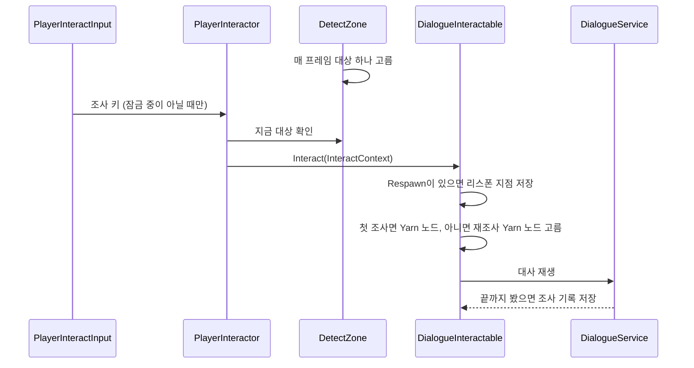

# 상호작용
---
- 라리스가 앞에 있는 것을 조사 키(Z)로 조사하는 시스템.

- 조사 대상은 라리스 주변에서 거리·바라보는 각도 안에 있는 것 중 가장 가까운 하나.
	- 기본값: 거리 1.5, 좌우 45도 (`InteractionSettings`)
	- 바라보는 방향은 `PlayerMovement`가 정함. → [[플레이어 시스템]]

- 조사하면 대상마다 하는 일이 다름.
	- 대사 재생: `DialogueInteractable`
	- 죽음: `DeathInteractable` → [[죽음 시스템]]

- 대사를 끝까지 보면 조사 기록에 남음.
	- 다음 조사부터는 재조사 Yarn 노드(`{노드}_Recheck`)를 재생.

# 구성
---

| 이름                     | 하는 일                                                                  |
| ---------------------- | --------------------------------------------------------------------- |
| `PlayerInteractInput`  | 조사 키 입력을 받음. 입력 잠금 중이면 무시. → [[세션 시스템]]                            |
| `DetectZone`           | 조사될 대상 하나를 매 프레임 고름. 라리스의 자식에 붙음.                                  |
| `InteractionSettings`  | 조사 거리·각도 설정 애셋. `Assets/Data/InteractionSettings.asset`               |
| `PlayerInteractor`     | 조사 키가 눌리면 `DetectZone`이 고른 대상의 `Interact`를 부름.                        |
| `IInteractable`        | 조사 대상의 공통 모양. `CanInteract`, `Interact`.                              |
| `InteractContext`      | 조사할 때 대상에게 넘기는 값. `DialogueService`, 조사 기록.                        |
| `Interactable`         | 조사 대상 컴포넌트의 부모. 켜져 있는 동안만 조사 가능.                                      |
| `DialogueInteractable` | 조사하면 Yarn 대사를 재생. 같은 오브젝트에 `Respawn`이 있으면 리스폰 지점도 저장. → [[죽음 시스템]] |
| `DialogueNodeNames`    | Yarn 노드 이름 규칙. 재조사 노드 이름을 만듦.                                         |
| `InvestigatedNodeIds`  | 조사 기록을 세이브에 남김. → [[세이브 시스템]]                                         |
| `GameSession`          | 실행 중 조사 기록(`Investigated`)을 들고 있음. 실행 시작 때 세이브에서 채움. → [[세션 시스템]]     |

# 흐름
---

- `DeathInteractable`은 대사를 재생하지 않고 바로 죽음으로 넘어감. → [[죽음 시스템]]

# 쓰는 법
---
- **조사 대상 만들기**
	1. 오브젝트에 콜라이더와 `DialogueInteractable`을 붙임.
	2. 오브젝트 Layer를 `Interactable`로 바꿈.
		- 다른 Layer면 `DetectZone`이 후보로 모으지 않음.
	3. `dialogueNodeId`에 Yarn 노드 이름을 적음.
	4. Yarn에 같은 이름의 Yarn 노드를 씀.

- **다시 조사할 때 다른 대사**
	- Yarn에 `{노드}_Recheck` Yarn 노드를 씀.
		- Ex. `Stone` → `Stone_Recheck`
	- 없으면 첫 대사를 반복.

- **조사 범위 바꾸기**
	- `InteractionSettings` 애셋의 거리·각도를 바꿈.

# 확인 필요
---
- 지금 무엇이 조사될지 화면에 표시가 없음.
	- `CurrentTarget`을 읽는 건 `PlayerInteractor`뿐.

- 대사를 중간에 끊으면 조사 기록에 남지 않음.
	- 끝까지 봐야 재조사 Yarn 노드로 넘어감.

- 같은 Yarn 노드 이름을 쓰는 대상은 조사 기록을 공유함.

- 아이템을 줍거나 쓰는 조사는 아직 없음.
