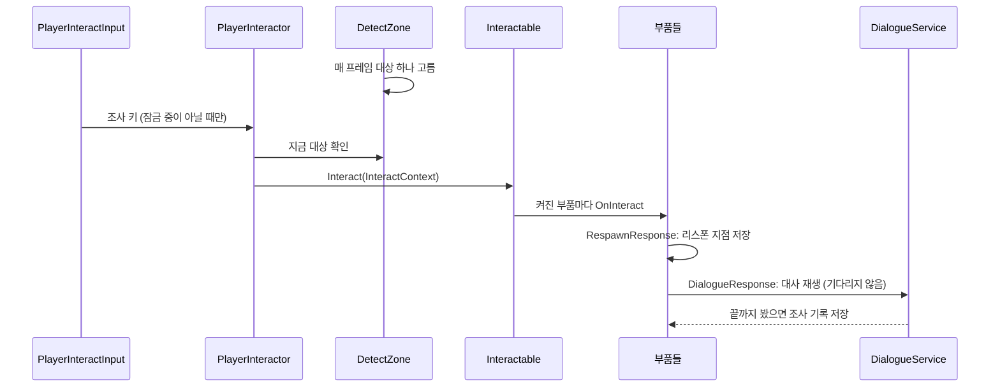

# 상호작용
---
- 소녀가 앞에 있는 것을 조사 키(Z)로 조사하는 시스템.

- 조사 대상은 소녀 주변에서 거리·바라보는 각도 안에 있는 것 중 가장 가까운 하나.
	- 기본값: 거리 1.5, 좌우 45도 (`InteractionSettings`)
	- 바라보는 방향은 `PlayerMovement`가 정함. → [[플레이어 시스템]]

- 조사 대상은 진입점(`Interactable`) 하나와 부품(`IInteractResponse`) 여러 개로 이루어짐.
	- 조사되면 진입점이 같은 오브젝트의 부품을 모두 실행함.
	- 부품마다 하는 일이 다름.
		- 대사 재생: `DialogueResponse`
		- 리스폰 지점 저장: `RespawnResponse` → [[죽음 시스템]]
		- 죽음: `DeathResponse` → [[죽음 시스템]]
		- 등불 켜기: `LampResponse` → [[빛 시스템]]

- 대사를 끝까지 보면 조사 기록에 남음.
	- 다음 조사부터는 재조사 Yarn 노드(`{노드}_Recheck`)를 재생.

# 구성
---

| 이름                    | 하는 일                                                                  |
| --------------------- | --------------------------------------------------------------------- |
| `PlayerInteractInput` | 조사 키 입력을 받음. 입력 잠금 중이면 무시. → [[세션 시스템]]                            |
| `DetectZone`          | 조사될 대상 하나를 매 프레임 고름. 소녀의 자식에 붙음.                                  |
| `InteractionSettings` | 조사 거리·각도 설정 애셋. `Assets/Data/InteractionSettings.asset`               |
| `PlayerInteractor`    | 조사 키가 눌리면 `DetectZone`이 고른 대상의 `Interact`를 부름.                        |
| `IInteractable`       | 조사 대상의 공통 모양. `CanInteract`, `Interact`.                              |
| `InteractContext`     | 조사할 때 대상에게 넘기는 값. `DialogueService`, 조사 기록.                        |
| `Interactable`        | 조사 대상의 진입점. 오브젝트마다 하나. 켜져 있는 동안만 조사 가능. 조사되면 켜진 부품을 모두 실행.        |
| `IInteractResponse`   | 조사되면 실행되는 부품의 공통 모양. `OnInteract`.                                    |
| `DialogueResponse`    | 조사하면 Yarn 대사를 재생.                                                     |
| `RespawnResponse`     | 조사하면 리스폰 지점을 저장. → [[죽음 시스템]]                                        |
| `DialogueNodeNames`   | Yarn 노드 이름 규칙. 재조사 노드 이름을 만듦.                                         |
| `InvestigatedNodeIds` | 조사 기록을 세이브에 남김. → [[세이브 시스템]]                                         |
| `GameSession`         | 실행 중 조사 기록(`Investigated`)을 들고 있음. 실행 시작 때 세이브에서 채움. → [[세션 시스템]]     |

# 흐름
---

- 부품은 같은 프레임에 모두 실행됨.
	- 대사는 시작만 하고 기다리지 않음. 그래서 부품 순서와 상관없이 리스폰 저장은 대사 첫 줄보다 먼저 끝남.

- `DeathResponse`는 대사를 재생하지 않고 바로 죽음으로 넘어감. → [[죽음 시스템]]

# 쓰는 법
---
- **조사 대상 만들기**
	1. 오브젝트에 콜라이더와 `DialogueResponse`를 붙임.
		- `Interactable`은 자동으로 같이 붙음.
	2. 오브젝트 Layer를 `Interactable`로 바꿈.
		- 다른 Layer면 `DetectZone`이 후보로 모으지 않음.
	3. `dialogueNodeId`에 Yarn 노드 이름을 적음.
	4. Yarn에 같은 이름의 Yarn 노드를 씀.

- **조사 결과 더하기**
	- 같은 오브젝트에 부품을 더 붙임.
		- Ex. 리스폰 지점: `Interactable` + `DialogueResponse` + `RespawnResponse` + `LampResponse`
	- 새 부품은 `IInteractResponse`를 구현하고 `[RequireComponent(typeof(Interactable))]`를 붙임.
		- `OnInteract`는 같은 프레임 안에 돌아와야 함. 오래 걸리는 일은 시작만 함.
	- 부품을 끄면 그 부품만 실행되지 않음.

- **다시 조사할 때 다른 대사**
	- Yarn에 `{노드}_Recheck` Yarn 노드를 씀.
		- Ex. `Stone` → `Stone_Recheck`
	- 없으면 첫 대사를 반복.

- **조사 범위 바꾸기**
	- `InteractionSettings` 애셋의 거리·각도를 바꿈.

# 확인 필요
---
- 지금 무엇이 조사될지 화면에 표시가 없음.
	- `CurrentTarget`을 읽는 건 `PlayerInteractor`뿐.

- 대사를 중간에 끊으면 조사 기록에 남지 않음.
	- 끝까지 봐야 재조사 Yarn 노드로 넘어감.

- 같은 Yarn 노드 이름을 쓰는 대상은 조사 기록을 공유함.

- 아이템을 줍거나 쓰는 조사는 아직 없음.
