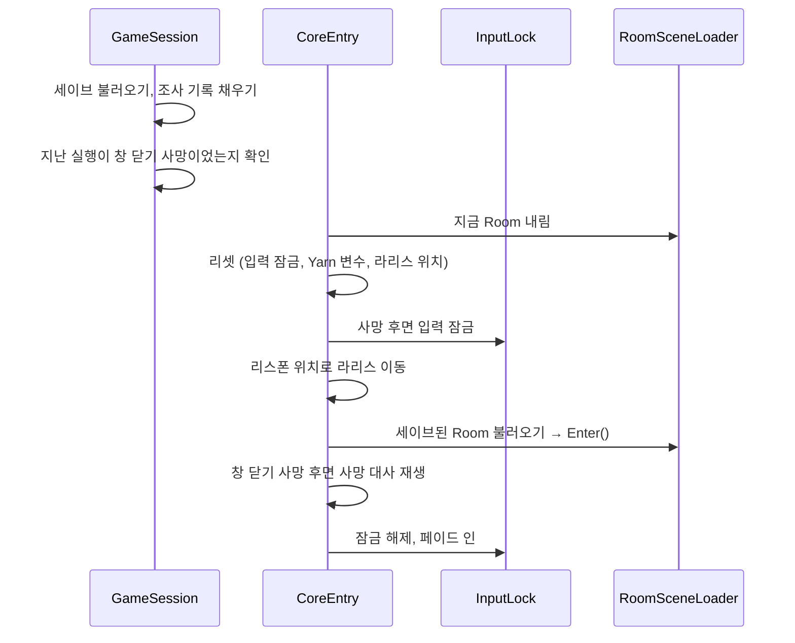

# 세션
---
- 게임 실행의 시작과 끝, 그 사이의 입력 잠금과 페이드를 맡는 시스템.

- 시작: 세이브를 불러오고, 저장된 Room과 리스폰 위치에서 시작.
	- 죽어서 다시 시작할 때도 같은 길을 탐. → [[죽음 시스템]]

- 끝은 두 가지.
	- 정상 종료: Yarn 커맨드 `<<QuitNormally>>`로만 됨. → [[대화 시스템]]
	- 창 닫기: 정상 종료가 아니면 전부 창 닫기 사망. → [[죽음 시스템]]

# 구성
---

| 이름                      | 하는 일                                                                          |
| ----------------------- | ----------------------------------------------------------------------------- |
| `GameSession`           | 실행 시작 때 세이브를 불러오고 조사 기록을 메모리에 채움. 지난 실행이 창 닫기 사망이었는지 기억함. → [[세이브 시스템]] |
| `CoreEntry`             | `Core` 씬의 시작점. 시작·사망 후 다시 시작을 맡음. 리셋 → 리스폰 위치로 이동 → Room 불러오기 → 페이드 인.     |
| `InputLock`             | 입력 잠금. 사유별로 횟수를 셈. 하나라도 걸려 있으면 라리스가 움직이지 않음.                                   |
| `InputLockReason`       | 잠금 사유: 대화, 사망, Room 이동.                                                       |
| `ScreenFader`           | 화면을 검게 덮고 걷어 냄. 페이드 0.2초, 검은 화면 유지 0.3초.                                         |
| `NormalQuit`            | 정상 종료. 종료 상태를 저장하고 게임을 끔.                                                     |
| `QuitHooks`             | 창 닫기(X, Alt+F4, 작업 끝내기)를 감지해 창 닫기 사망으로 기록. 빌드에서만 동작.                             |
| `WindowsSessionEndHook` | 윈도우 종료·로그오프를 감지해 창 닫기 사망으로 기록.                                               |

# 흐름
---

- `GameSession`은 실행할 때 한 번만 돔. 죽어서 다시 시작할 때는 `CoreEntry`부터.

- Room 불러오기 → [[Room 시스템]]

# 쓰는 법
---
- **입력 잠그기**
	- `InputLock.Lock(사유)`와 `Unlock(사유)`를 짝지어 부름.
	- 새 사유가 필요하면 `InputLockReason`에 추가.

- **페이드**
	- `ScreenFader.FindOrCreate`로 페이더를 얻고 `FadeOut()`, `FadeIn()`을 끝까지 돌림.
	- 시간 값은 `Prefabs/UI/ScreenFader`에서 바꿈.

- **정상 종료**
	- Yarn 노드에 `<<QuitNormally>>`를 씀. → [[대화 시스템]]

- **에디터에서 창 닫기 시험**
	- 에디터의 플레이 중지는 창 닫기가 아님.
	- Unity 메뉴 `Tools > 창 닫기 시뮬레이션`을 씀.

# 확인 필요
---
- 정상 종료를 부르는 Yarn 노드가 없어서, 지금은 어떻게 끄든 창 닫기 사망.
	- 세이브 포인트를 만들 때 여기에 연결해야 함.

- 다시 시작할 때 Yarn 변수가 지워짐. → [[대화 시스템]]

- 사망 후 진입에서 입력 잠금을 페이드 인보다 먼저 풂.
	- 페이드 인 중에도 움직일 수 있음.
