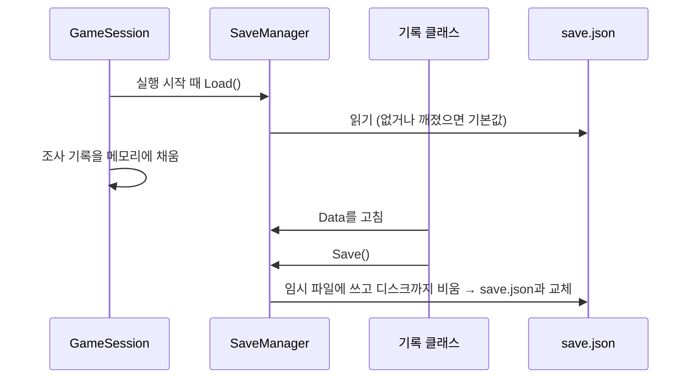

# 세이브
---
- 게임 진행 기록을 `save.json` 하나에 저장하고 불러오는 시스템.

- 세이브 슬롯이나 저장 버튼은 없음.
	- 기록이 생기는 순간 바로 저장됨.

- 게임 폴더: `사용자 폴더\Salbyeol\`
	- `save.json`: 세이브 파일
	- `Corpses\`: 시체 파일 폴더 → [[죽음 시스템]]

# 구성
---

| 이름                    | 하는 일                                                                  |
| --------------------- | --------------------------------------------------------------------- |
| `SaveManager`         | `save.json` 읽기·쓰기. 메모리의 세이브 내용(`Data`)을 들고 있음.                       |
| `SaveData`            | 세이브 내용. 필드 이름이 그대로 JSON 키.                                           |
| `GameFolderPaths`     | 게임 폴더, 세이브 파일, 시체 폴더 경로.                                             |
| `RespawnPoint`        | 리스폰 위치와 Room 이름을 저장. → [[죽음 시스템]]                                   |
| `InvestigatedNodeIds` | 조사를 마친 Yarn 노드 이름을 저장. → [[상호작용 시스템]]                               |
| `DeathRecords`        | 죽은 사망 Yarn 노드 이름을 저장. → [[죽음 시스템]]                                  |
| `ExitRecorder`        | 지난 실행이 어떻게 끝났는지(정상 종료, 창 닫기 사망)를 저장. → [[죽음 시스템]]                    |

## 저장되는 것

| 필드                    | 내용                                       | 쓰는 곳                                  |
| --------------------- | ---------------------------------------- | ------------------------------------- |
| `respawnPosition`     | 리스폰 위치. `hasRespawnPosition`이 false면 씬의 기본 위치. | `RespawnPoint`                        |
| `roomName`            | 시작할 때 불러올 Room 씬 이름. 비어 있으면 기본 Room.        | `RespawnPoint` → [[Room 시스템]]          |
| `investigatedNodeIds` | 조사를 마친 Yarn 노드 이름                         | `InvestigatedNodeIds`                 |
| `diedNodeIds`         | 죽은 사망 Yarn 노드 이름. 같은 이름은 한 번만.             | `DeathRecords`, `ExitRecorder`        |
| `exitState`           | 지난 실행의 끝: 없음 / 정상 종료 / 창 닫기 사망 대기          | `ExitRecorder`                        |
| `solvedPuzzleIds`     | 푼 퍼즐 이름                                  | 없음                                    |

# 흐름
---

- 불러오기는 실행 시작 때 한 번. → [[세션 시스템]]
	- 죽어서 다시 시작할 때는 다시 불러오지 않고 메모리의 `Data`를 씀.

- 저장 시점
	- 리스폰 지점이 있는 대상을 조사할 때 → [[상호작용 시스템]]
	- 대사를 끝까지 봤을 때 (조사 기록)
	- 죽을 때 (사망 기록) → [[죽음 시스템]]
	- 창을 닫을 때, 정상 종료할 때, 실행을 시작할 때 (종료 상태)

# 쓰는 법
---
- **새 기록 추가**
	1. `SaveData`에 필드를 추가함.
	2. 기록 클래스(`DeathRecords`처럼)를 만들어 `SaveManager.Data`를 고치고 `Save()`를 부름.
		- 이름 목록이면 `SaveManager.AddUnique`를 쓰면 중복 없이 추가·저장됨.

- **세이브 지우고 처음부터**
	- Unity 메뉴 `Tools > 데이터 초기화`

- **세이브 폴더 열기**
	- Unity 메뉴 `Tools > Save > Open Save Folder`

# 확인 필요
---
- `solvedPuzzleIds`는 아무 데도 쓰지 않음.

- `SaveData` 필드 이름을 바꾸면 옛 세이브의 그 값이 조용히 기본값이 됨.

- 게임 폴더 이름이 `Salbyeol`임. 지금 게임에 맞는 이름인지 정해야 함.

- 세이브 파일이 깨졌으면 기본값으로 시작하고, 다음 저장 때 덮어씀.
