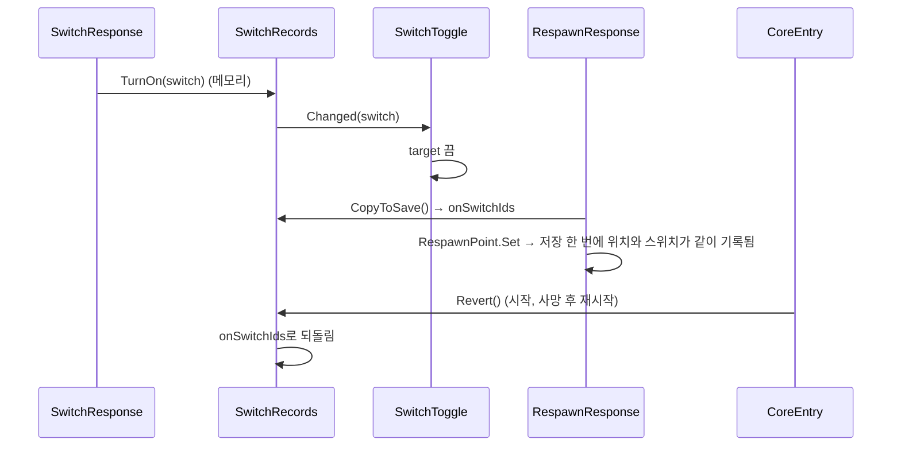

# 스위치
---
- 한 번 일어나면 이후 장면이 달라지는 일을 기억하는 시스템.
	- Ex. 열쇠를 주움 → 열쇠가 사라지고 잠긴 문이 열림.

- 스위치는 켜졌는지만 기억함. 켜졌을 때 무엇이 달라지는지는 읽는 쪽이 정함.

- 켜는 쪽과 읽는 쪽이 같은 `Switch` 애셋을 가리켜 하나로 묶임.
	- id 문자열은 직접 적지 않음.

- 켠 스위치는 리스폰 지점에서 확정해야 세이브에 남음. → [[세이브 시스템]]
	- 죽거나 다시 켜면 마지막으로 확정한 상태로 되돌아감.
	- 확정하지 않고 켠 스위치는 꺼진 것이 됨.
		- Ex. 열쇠를 줍고 리스폰 지점을 조사하지 않은 채 죽으면 열쇠가 다시 나옴.

# 구성
---

| 이름               | 하는 일                                                                                                                   |
| ---------------- | ---------------------------------------------------------------------------------------------------------------------- |
| `Switch`         | 스위치 하나를 가리키는 이름표 애셋. 상태는 없음. id는 애셋의 guid로 자동으로 채워짐. `Assets/Data/Switches/`                                      |
| `SwitchRecords`  | 켜진 스위치를 메모리에 기억함(static). 켜기(`TurnOn`), 묻기(`IsOn`), 새로 켜지면 알림(`Changed`). 세이브에 확정(`CopyToSave`, `Commit`), 되돌리기(`Revert`). |
| `SwitchResponse` | 조사되면 스위치를 켜는 부품. 열쇠처럼 줍는 물건에 붙임. → [[상호작용 시스템]]                                                                       |
| `SwitchToggle`   | 스위치가 켜져 있으면 `target`을 끔. 방에 들어올 때 한 번 보고, 방 안에서 켜지면 `Changed`로 받음.                                                     |
| `LockedDoor`     | 스위치가 켜져야 들어갈 수 있는 문. → [[Room 시스템]]                                                                                  |

# 흐름
---

- `Revert`는 Room을 불러오기 전에 불림. 그래서 `Changed`로 알리지 않음.
	- 읽는 쪽은 Room이 불러와질 때 `IsOn`으로 새 상태를 봄.

- `LockedDoor`는 알림을 받지 않음. 소녀가 문 칸에 닿을 때마다 `IsOn`으로 물음.

# 쓰는 법
---
- **스위치 만들기**
	1. `Assets/Data/Switches/`에서 우클릭 → `Create` → `Gaze` → `Switch`.
		- Ex. `Switch_Room3Open`

- **열쇠 놓기**
	1. 열쇠 오브젝트에 `Interactable`과 `SwitchResponse`를 붙이고 `targetSwitch`에 스위치 애셋을 넣음.
		- 주울 때 대사가 필요하면 `DialogueResponse`도 같이 붙임. → [[대화 시스템]]
	2. 같은 오브젝트에 `SwitchToggle`을 붙이고 `watchedSwitch`에 같은 애셋을 넣음.
		- 주우면 사라지고, 방에 다시 들어와도 나오지 않음.
		- `target`을 비우면 자기 자신을 끔.

- **잠긴 문 놓기**
	1. `LockedDoor` Pb(`Prefabs/SceneDefault/Door/`)를 놓고 `NormalDoor`처럼 행선지를 이음. → [[Room 시스템]]
	2. `requiredSwitch`에 열쇠와 같은 스위치 애셋을 넣음.
	3. 잠겨 있을 때 대사는 문 앞에 조사 대상을 따로 둠.
		- `LockedDoor`는 대사를 재생하지 않음.

- **스위치가 켜졌는지 묻기**
	- `SwitchRecords.IsOn(switch)`
	- 방 안에서 켜지는 것까지 보려면 `OnEnable`에서 `IsOn`으로 먼저 보고, `SwitchRecords.Changed`를 구독함.
		- 이미 켜진 스위치를 다시 켜면 알림이 가지 않음.

# 확인 필요
---
- `SwitchRecords.Commit`(확정 + 저장)을 부르는 곳이 없음.
	- 리스폰 지점은 `CopyToSave`만 부르고 저장은 `RespawnPoint.Set`이 함.
	- 리스폰 지점 밖에서 확정해야 하는 경우가 생기면 씀.

- 스위치를 끄는 방법은 없음. 켜지기만 함.

- `SwitchToggle`은 켜진 스위치에 오브젝트를 끄기만 함. 켜는 쪽(스위치가 켜지면 나타나는 오브젝트)은 없음.

- `Switch`의 id는 에디터에서 애셋이 검사될 때 맞춰짐(`OnValidate`).
	- 애셋을 복제한 직후 한 번도 선택하지 않고 빌드하면 id가 원본과 같을 수 있음.

- 지금 쓰는 스위치는 `Switch_Room3Open` 하나.
	- 열쇠는 `Room02`, 잠긴 문은 `LivingRoom`(→ `Room03`).
