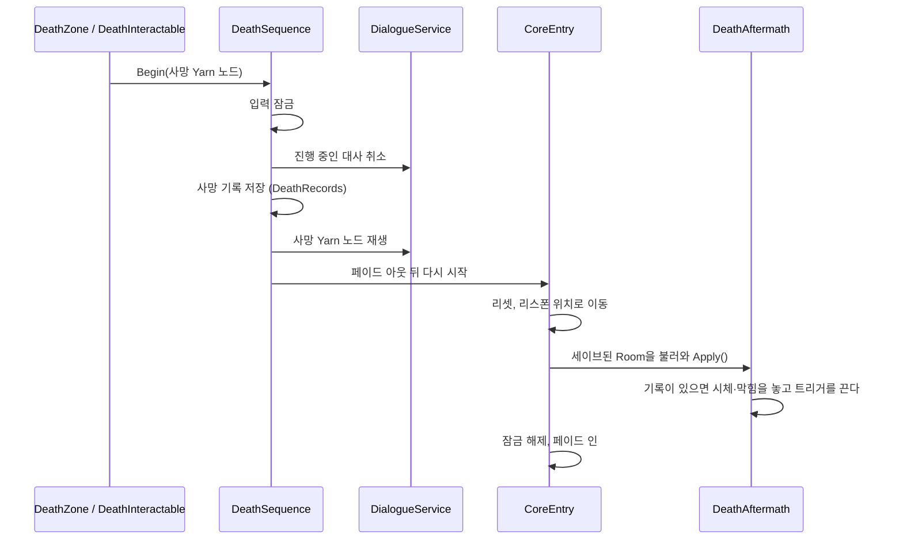

# 죽음
---
- 라리스가 죽고, 사망 대사를 보고, 마지막 리스폰 지점에서 다시 시작하는 시스템.

- 한 번 죽은 자리에는 시체가 남음.

- 외면: 라리스가 다시 죽음 트리거를 발동시키려고 해도, 죽음 트리거는 발동되지 않음.

## 죽음 트리거
### 인게임
- 위험한 곳에 들어감.
- 위험한 것을 조사.
### 메타픽션
- 세이브 포인트 외에서 창 닫기.

# 구성
---

| 이름                             | 하는 일                                                |
| ------------------------------ | --------------------------------------------------- |
| `DeathZone`                    | 라리스가 영역에 들어오면 죽임                                    |
| `DeathInteractable`            | 라리스가 조사하면 죽임.                                       |
| `IDeathSource`                 | 위 둘의 공통 모양. 사망 Yarn 노드 이름을 제공.                      |
| `DeathSequence`                | 사망 처리 전체를 진행.                                        |
| `DeathRecords`                 | 사망 Yarn 노드 이름을 세이브에 남김.                               |
| `DeathAftermath`               | Room에 들어올 때 사망 기록이 있으면 시체 등을 놓고 트리거를 끔.             |
| `DeathRefusalZone`             | 처음 다가올 때 외면 대사를 한 번 재생. 막는 건 같은 프리팹의 콜라이더에서 처리.  |
| `Respawn` · `RespawnPoint`     | 조사하면 리스폰 지점을 갱신·저장.                                 |
| `ExitRecorder` · `CorpseFiles` | 창 닫기 죽음을 저장하고 게임 폴더에 `CorpseNNN.txt`를 만듦.           |
| `CoreEntry`                    | 다시 시작. 리셋, 리스폰 위치로 이동, Room 불러오기, 페이드 인.         |

# 흐름
---

- 창 닫기 죽음은 이 흐름을 타지 않음.
	- 창을 닫는 순간 기록과 시체 파일을 저장.
	- 다음 실행의 `CoreEntry`가 `Death_CloseWindow` Yarn 노드만 재생.

# 쓰는 법
---
- **사망 트리거 제작**
	1. Room 씬에 `DeathZone`(Trigger 콜라이더 필요) 또는 `DeathInteractable`을 놓는다.
	2. 사망 Yarn 노드 이름을 적는다.
		- Ex. `Death_Falling001`
	3. Yarn에 같은 이름의 노드를 쓴다.
	
- **사망 후 오브젝트**
	1. 같은 오브젝트에 `DeathAftermath`를 붙이고 `source`에 1의 트리거를 넣는다.
	2. `spawns`에 시체 Pb와 추가로 생기는 Pb를 넣는다.
	3. `deactivate`에 1의 트리거를 넣어 다시 죽지 않게 한다.
	
- **외면 대사**
	- 외면할 프리팹의 `DeathRefusalZone`에 외면 Yarn 노드 이름을 적는다.
		- Ex. `Death_Falling001_Refuse`
	- 끝까지 보면 조사 기록에 남아 다시 나오지 않는다.
	
- **리스폰 지점**
	- `DialogueInteractable`이 있는 오브젝트에 `Respawn`을 붙인다.
		- 조사하는 순간 그 위치와 Room이 저장된다.

# 확인 필요
---
- 시체 파일은 창 닫기 죽음에서만 생김.
	- 게임 안의 죽음에서는 생기지 않음.

- 피할 수 없는 죽음(추격 등)을 만드는 장치가 없음.
	- `DeathAftermath`를 붙이지 않은 죽음은 반복되지만, 그뿐.

- HP가 없다. 죽음은 한 번에 일어남.

- 세이브 포인트가 아직 없음.
	- 정상 종료(`NormalQuit`)를 부르는 대화 노드가 없어서 지금은 창을 어디서 닫든 죽음이 됨.
