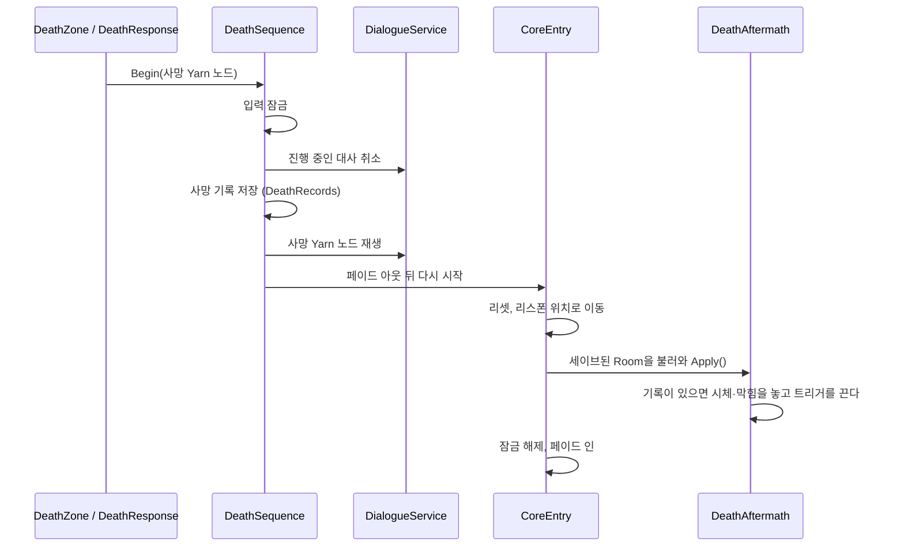

# 죽음
---
- 소녀가 죽고, 사망 대사를 보고, 마지막 리스폰 지점에서 다시 시작하는 시스템.

- 한 번 죽은 자리에는 시체가 남음.

- 외면: 소녀가 다시 죽음 트리거를 발동시키려고 해도, 죽음 트리거는 발동되지 않음.

## 죽음 트리거
### 인게임
- 위험한 곳에 들어감.
- 위험한 것을 조사.
### 메타픽션
- 세이브 포인트 외에서 창 닫기.

# 구성
---

| 이름                                 | 하는 일                                                            |
| ---------------------------------- | --------------------------------------------------------------- |
| `DeathZone`                        | 소녀가 영역에 들어오면 죽임                                                 |
| `DeathResponse`                    | 소녀가 조사하면 죽임. 조사 부품. → [[상호작용 시스템]]                              |
| `IDeathSource`                     | 위 둘의 공통 모양. 사망 Yarn 노드 이름을 제공.                                  |
| `DeathSequence`                    | 사망 처리 전체를 진행.                                                   |
| `DeathRecords`                     | 사망 Yarn 노드 이름을 세이브에 남김.                                         |
| `DeathAftermath`                   | Room에 들어올 때 사망 기록이 있으면 시체 등을 놓고 트리거를 끄고, 꺼 둔 오브젝트(외면 구역 등)를 켬. |
| `DialogueZone`                     | 처음 다가올 때 외면 대사를 한 번 재생. → [[대화 시스템]] 막는 건 같은 프리팹의 콜라이더에서 처리. |
| `RespawnResponse` · `RespawnPoint` | 조사하면 리스폰 지점을 갱신·저장. 조사 부품. → [[상호작용 시스템]]                       |
| `ExitRecorder` · `CorpseFiles`     | 창 닫기 죽음을 저장하고 게임 폴더에 `CorpseNNN.txt`를 만듦.                       |
| `CoreEntry`                        | 다시 시작. 리셋, 리스폰 위치로 이동, Room 불러오기, 페이드 인. → [[세션 시스템]]        |

# 흐름
---

- 창 닫기 죽음은 이 흐름을 타지 않음.
	- 창을 닫는 순간 기록과 시체 파일을 저장.
	- 다음 실행의 `CoreEntry`가 `Death_CloseWindow` Yarn 노드만 재생.

- 사망 Yarn 노드에서 띄운 컷신은 대사가 끝나도 남아 페이드 아웃까지 화면을 덮음.
	- 리스폰할 때 `CoreEntry`가 닫음. 다시 시작에 실패하면 `DeathSequence`가 닫음.
	- 닫으면 페이드 아웃이 투명에서 시작해 장면이 잠깐 보이기 때문.

- 리스폰 대사가 있으면 페이드 인이 끝난 뒤 재생함.
	- 페이드 인 동안 Death 잠금을 유지하고, 대사가 끝날 때까지 대화 잠금으로 이어짐.
	- 사망 상태(`DeathSequence.IsActive`)는 대사 전에 끝남. 리스폰 대사의 컷신은 대화가 끝나면 닫힘.

# 쓰는 법
---
- **사망 트리거 제작**
	1. Room 씬에 `DeathZone`(Trigger 콜라이더 필요) 또는 `DeathResponse`(콜라이더, Layer `Interactable`)를 놓는다.
	2. 사망 Yarn 노드 이름을 적는다.
		- Ex. `Death_Falling001`
	3. Yarn에 같은 이름의 노드를 쓴다.
	
- **사망 후 오브젝트**
	1. 같은 오브젝트에 `DeathAftermath`를 붙이고 `source`에 1의 트리거를 넣는다.
	2. `spawns`에 시체 Pb와 추가로 생기는 Pb를 넣는다.
	3. `deactivate`에 1의 트리거를 넣어 다시 죽지 않게 한다.
	4. 사망 뒤에만 보일 오브젝트는 꺼 둔 채로 씬에 두고 `activate`에 넣는다.
		- Ex. 시체가 없는 낙사: 부모 `DeathAftermath` 아래에 자식 `DeathTrigger`(`deactivate`)와 꺼 둔 자식 `RefusalZone`(`activate`)을 둠.
		- 켜진 채로 넣으면 Inspector에 경고가 뜸. 사망 기록이 없어도 보이기 때문.
		- `DeathAftermath`를 붙인 오브젝트는 켜 둔다.
	
- **외면 대사**
	- 외면할 프리팹의 `DialogueZone`에 외면 Yarn 노드 이름(`dialogueNodeId`)을 적는다.
		- Ex. `Death_Falling001_Refuse`
	- 끝까지 보면 조사 기록에 남아 다시 나오지 않는다.

- **리스폰 대사**
	- Yarn에 `{사망 노드}_Respawn` 노드를 쓴다. 그 죽음 뒤 리스폰할 때마다 재생된다.
		- Ex. `Apartment_FallingDeath` → `Apartment_FallingDeath_Respawn`
	- 노드가 없으면 아무것도 재생하지 않는다.
	- 씬에는 아무것도 놓지 않는다. 리스폰 지점이 어느 Room이든 같다.
	
- **리스폰 지점**
	- 조사 대상에 `RespawnResponse`를 붙인다. → [[상호작용 시스템]]
		- 조사하는 순간 그 위치와 Room이 저장된다.

# 확인 필요
---
- 시체 파일은 창 닫기 죽음에서만 생김.
	- 게임 안의 죽음에서는 생기지 않음.

- 피할 수 없는 죽음(추격 등)을 만드는 장치가 없음.
	- `DeathAftermath`를 붙이지 않은 죽음은 반복되지만, 그뿐.

- HP가 없다. 죽음은 한 번에 일어남.

- 리스폰 대사는 같은 죽음을 겪을 때마다 나옴.
	- `DeathAftermath`로 트리거를 끄는 죽음은 한 번뿐이라 상관없음. 반복되는 죽음에 쓰려면 처음만 재생하게 바꿔야 함.

- 세이브 포인트가 아직 없음.
	- 정상 종료(`NormalQuit`)를 부르는 대화 노드가 없어서 지금은 창을 어디서 닫든 죽음이 됨.
