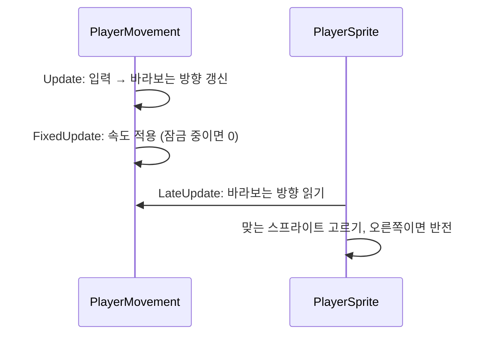

# 플레이어
---
- 라리스를 움직이고, 바라보는 방향에 맞는 그림을 보여 주는 시스템.

- 8방향 이동. 속도 3.

- 바라보는 방향(`Facing`)은 조사 대상을 고를 때도 씀. → [[상호작용 시스템]]

- 입력이 잠겨 있으면 멈춤. → [[세션 시스템]]

# 구성
---

| 이름               | 하는 일                                                                     |
| ---------------- | ------------------------------------------------------------------------ |
| `PlayerMovement` | 8방향 이동과 바라보는 방향. 라리스를 순간이동시키는 `MoveTo`, 콜라이더가 라리스 몸인지 확인하는 `TryFrom`.  |
| `PlayerSprite`   | 바라보는 방향에 맞는 스프라이트를 보여 줌. 왼쪽 계열 그림만 있고, 오른쪽은 좌우 반전.                    |

- 조사 쪽(`DetectZone`, `PlayerInteractor`, `PlayerInteractInput`)은 `Player/` 폴더에 있지만 → [[상호작용 시스템]]

# 흐름
---

- 대각선을 보다가 키 하나를 떼면 0.1초 기다린 뒤 상하좌우로 바꿈.
	- 그 사이 남은 키도 떼면 대각선 방향이 유지됨.

# 쓰는 법
---
- **이동 속도 바꾸기**
	- `Core` 씬의 라리스에서 `PlayerMovement`의 `moveSpeed`를 바꿈.

- **라리스 그림 바꾸기**
	- `PlayerSprite`에 다섯 장을 넣음: 아래, 위, 왼쪽, 왼쪽 아래, 왼쪽 위.
	- 오른쪽 계열은 자동으로 반전.

- **트리거에서 라리스인지 확인**
	- `PlayerMovement.TryFrom(콜라이더, out 라리스)`를 씀.
		- 조사 감지 원이 아니라 몸 콜라이더만 라리스로 봄.

# 확인 필요
---
- 걷기 애니메이션이 없음. 방향별로 한 장씩.

- 라리스는 약 12×16px(한 칸), 16 PPU.
	- 카메라가 아직 20×15칸이 아니라 화면에서 작게 보임.
